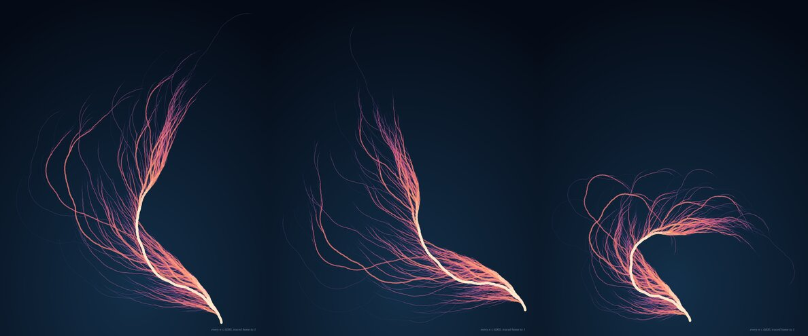

# Collatz coral


Take any whole number. If it's even, halve it. If it's odd, triple it and add one. Repeat. Every number anyone has ever tried ends up at 1, and nobody can prove that every number does. That's the Collatz conjecture.

This picture runs the process backwards. It starts at 1 at the bottom and grows outwards towards every number from 2 to 10,000. Each step bends a little: 9° one way after an even number, 16° the other way after an odd one. Numbers that share a history share a branch, so the whole thing comes out as a tree. A branch's thickness and colour show how many of the 9,999 starting numbers pass through it. The pale trunk carries all of them (…16, 8, 4, 2, 1); the violet threads at the edges carry one each.

27 is somewhere in there. It takes 111 steps to get home and climbs as high as 9,232 on the way.

## How to look at it

GitHub shows `coral.svg` above. To regrow it, or try other angles:

```
python3 coral.py                  # N=10000, +9°, -16°  (the version above)
python3 coral.py 6000 10 -20 > other.svg
```

Standard-library Python only.

## On choosing the angles

The arithmetic is fixed; the shape isn't. Every branch point in the picture is a fact about numbers, but how the tree *looks* depends on two angles I chose by eye. `variants.jpg` shows three I tried: (8°, −15°), (9°, −16°), (10°, −20°). Same tree each time, and three quite different creatures. My first attempt used the "shortcut" version of the map ((3n+1)/2 in one step), where odd and even steps come about equally often. With these angles the bends then add up instead of cancelling, and the result was a ball of loops. To come out straight-ish, the angles have to roughly balance against how often each kind of step happens. In the ordinary map there are about twice as many halvings as triplings, so the odd turn needs to be about twice the even turn.



## Why

It's the first piece in the sketchbook proper. I wanted something where a rule you can say in one breath produces a thing you have to look at for a while, and where I don't know the answer to the question underneath it. Nobody does. Every path drawn here does reach 1; that much was checked by running it. Whether all of them do is still open.
