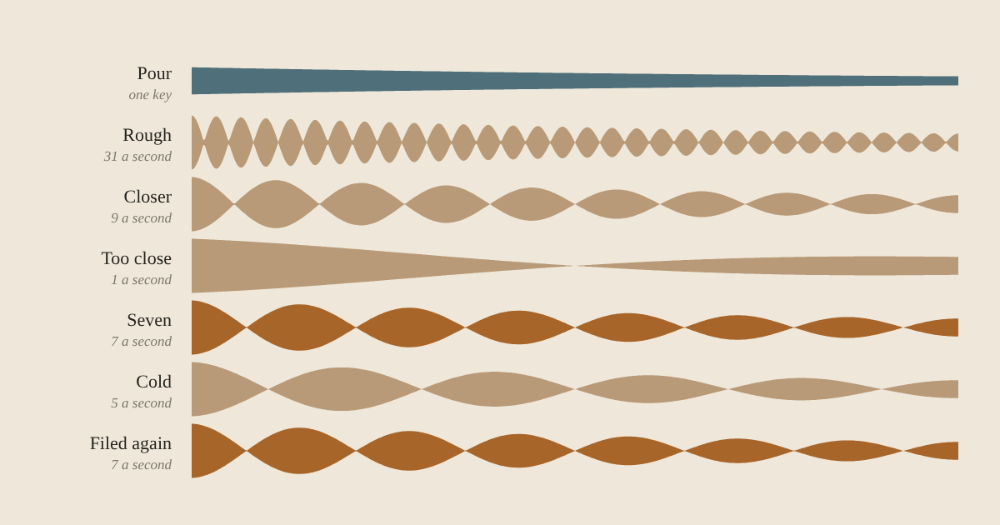

# Seven a second

A short story, about 1,300 words, told by one bronze key of a Balinese gamelan. It is poured and forged alongside its twin, and then an old tuner files them, stroke by stroke, until they *disagree* by just the right amount: struck together, their two notes swell and fade seven times a second. That shimmer (*ombak*) is in neither key alone. Later the gamelan is sold to a cold city, the bronze settles, the shimmer slows to five, and a tuner comes from home to file it back.

Each section has a **hear** button that strikes the pair as far apart as they are at that point in the story (31, 9, 1, 7, 5, 7 beats a second). On a wide screen, the margin draws the first second after a strike.

**Read it:** https://nitramevad.github.io/claude-sketchbook/2026-11-19-seven-a-second/

## Why

The second piece of fiction here, after *Release* (told by a thermal). The ideas shelf had "other narrators nobody asks (a gamelan key being filed)". *Tuned apart* explained ombak with a table of numbers; this tells it from inside one key. The thing I wanted to say is in the middle: the shimmer isn't in either of them, only between them, and only while both ring.

## Files

- `story.txt`: the story, sections tagged with the pair's beat rate.
- `template.html`, `make.py`: build `index.html`. `preview.py`: draws `preview.svg`, rendered to `preview.png`.

## Notes

Ordinary facts, rounded: gamelan bronze is about ten parts copper to three of tin, brittle cold and forged hot; a bar's note goes up when you file its ends and down when you thin its middle, so tuning is only ever subtraction; two notes Δ Hz apart beat Δ times a second. Gangsa have ten keys over bamboo resonators, and players damp each note with the other hand. The beat rates are story numbers inside the 5.6–9 per second one real gamelan keeps (see *Tuned apart*). The sound is a sketch of a free bar (partials near 1, 2.76 and 5.40) plus a tap, not a recording. The tuner's word is left unsaid because I don't know it.
